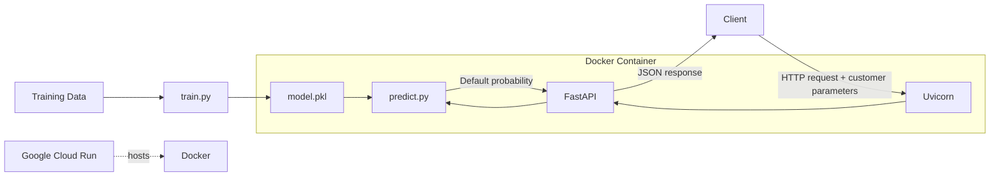

# Credit Card Default Prediction Service

## Overview
The system trains a machine-learning model for predicting credit-card default, saves it, then exposes predictions through a web API.
Main components:

* train.py: trains the ML model and serializes it to something like model.pkl.
* model.pkl: stores the trained model parameters so the model doesn't need retraining for every prediction.
* predict.py: loads the trained model and passes customer features into it.
* FastAPI: defines the HTTP API, validates incoming parameters and returns predictions as JSON.
* Uvicorn: the web server that runs the FastAPI application and listens for HTTP requests.
* Pipenv: manages Python packages and locks their versions using Pipfile and Pipfile.lock.
* Docker: packages the application, Python runtime and dependencies into a portable container.
* Google Cloud Run: runs that Docker container in Google Cloud and provides a scalable HTTPS endpoint.

## Training

```Python
# train.py
model.fit(X_train, y_train)
with open("model.pkl", "wb") as f:
    pickle.dump(model, f)
```

Ideally, model.pkl contains the whole preprocessing + prediction pipeline, so feature encoding/scaling is identical during training and prediction.
Prediction

```Python
# predict.py
with open("model.pkl", "rb") as f:
    model = pickle.load(f)
@app.get("/predict")
def predict(age: int, income: float, balance: float):
    X = [[age, income, balance]]
    probability = model.predict_proba(X)[0][1]
    return {"default_probability": probability}
```

A request might therefore look like:

```Bash
/predict?age=42&income=45000&balance=12000
```

## Architecture



## Deployment flow

```
Python code
    ↓
Pipenv dependencies
    ↓
Docker image
    ↓
Google Artifact Registry
    ↓
Google Cloud Run
    ↓
HTTPS prediction endpoint
```

So, in simple terms: train the model → pickle it → FastAPI exposes it → Uvicorn runs the API → Docker packages everything → Cloud Run hosts it.